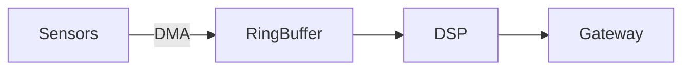

# Sieva Site Generator (v2)

[](https://golang.org/)
[](https://github.com/Crowiel/Sieva-Site-Generator)
[](https://github.com/Crowiel/Sieva-Site-Generator)
[](LICENSE)

A deterministic, ultra-fast static site generator engineered with **mechanical sympathy** for systems architects, embedded engineers, and minimalists. Built from the ground up in **Go**, it compiles static portfolios with build-time pre-rendered SVG Gantt charts, interactive pullout breadcrumb navigation, on-demand LaTeX math, Mermaid architecture diagrams, and zero runtime framework bloat.

---

## ⚡ Core Engineering Philosophy

Contemporary web development frequently burdens static content with multi-megabyte JavaScript frameworks, heavy client hydration routines, and browser-side chart libraries. 

**Sieva Site Generator (v2)** applies embedded systems principles to static web generation:

* **Zero Client Runtime Bloat**: 100% accessible, responsive, and functional with JavaScript disabled. Client stack is under **2.5 KB** of vanilla JS and **13 KB** of clean modern CSS.
* **Build-Time Vector Pre-rendering**: Project Gantt schedules are mathematically computed and emitted directly as standard, scalable `<svg>` vector paths during build time. **0ms client rendering execution**.
* **On-Demand Visualization Engines**: KaTeX (LaTeX math) and Mermaid.js (architecture diagrams) load strictly on-demand. Standard pages carry **0 KB** third-party library overhead.
* **Sub-150ms Deterministic Builds**: The entire site—Markdown parsing, syntax highlighting, directory URL structuring, asset copying, sitemaps, and SVG vector math—compiles in ~100–150ms.
* **Lighthouse Perfection**: Real-world metrics consistently deliver **0.11s LCP** (Largest Contentful Paint), **0.000 CLS** (Cumulative Layout Shift), and **0ms INP** (Interaction to Next Paint).
* **Upstream Git Safety**: Structured to allow users to fork and pull engine updates without overwriting private portfolio configurations or content.

---

## 🚀 Quick Start

### Prerequisites
* [Go 1.22+](https://golang.org/dl/) installed and on your `PATH`.

### 1. Build the Binary from Source
We distribute pure Go source code rather than unsigned executables:
```bash
go build -o sieva-ssg.exe main.go
```
*(On Linux or macOS, build with `go build -o sieva-ssg main.go`)*

### 2. Run Local Development Server
```bash
./sieva-ssg.exe dev --port 8000
```
Visit `http://localhost:8000`. The built-in dev server watches `content/`, `templates/`, `static/`, and configuration files, automatically rebuilding changes in under 150ms.

---

## ⚙️ Configuration Architecture (Upstream Safe)

The generator uses a two-tier configuration hierarchy designed specifically for git-based workflows:

| File | Purpose | Git Tracking |
| :--- | :--- | :--- |
| `config-default.json` | Upstream baseline defaults and template schema. | **Tracked** in Git |
| `config.json` | Your personal portfolio customizations and overrides. | **Ignored** in `.gitignore` |

### How It Works:
1. The engine first loads `config-default.json` as the base model.
2. If `config.json` exists, it overlays your customizations (name, domain, social links, descriptions) on top of the base.
3. When pulling new updates from the upstream repository (`git pull upstream main`), engine improvements and new default settings merge cleanly without wrecking your personal data.
4. The dev server live-reloads configuration changes dynamically on file save.

---

## 🛠️ CLI Commands & Build Modes

The generator clearly separates production portfolio builds from demonstration fixtures:

```bash
# Production Build (Excludes all content files starting with 'demo-')
./sieva-ssg.exe build

# Demo Build (Includes demo-* test fixtures, syntax guides, and reference projects)
./sieva-ssg.exe build-demo

# Start Development Server with live rebuilds (defaults to demo mode)
./sieva-ssg.exe dev --port 8000

# Serve static dist/ folder without file watcher
./sieva-ssg.exe serve --port 8000

# Clean output folder
./sieva-ssg.exe clean
```

---

## 📁 Repository Structure

```text
├── content/                     # Markdown and MDX content files
│   ├── about.mdx                # Standalone About page
│   ├── privacy.md               # Zero-tracking privacy statement
│   ├── blog/                    # Technical essays, guides, and articles (bundle folders)
│   │   ├── <article-slug>/      # Dedicated post bundle
│   │   │   ├── index.md(x)      # Article markdown content
│   │   │   └── img/             # Post-specific images -> /media/blog/<slug>/
│   │   └── demo-ssg-features... # Interactive syntax guide & test fixture
│   └── projects/                # Engineering project bundles
│       ├── <project-slug>/      # Dedicated project bundle
│       │   ├── index.md(x)      # Main project overview
│       │   ├── update-*.md(x)   # Subsequent revision logs & firmware updates
│       │   └── img/             # Project-specific images -> /media/projects/<slug>/
├── templates/                   # Clean HTML5 Go templates
│   ├── base.html                # Navigation, footer, theme switcher, modal
│   ├── index.html               # Minimal homepage with list rows
│   ├── project-single.html      # Project page with Gantt & pullout timeline
│   ├── blog-single.html         # Blog reading layout
│   └── ...
├── static/                      # Static client assets
│   ├── css/style.css            # Single unified stylesheet (<13KB)
│   ├── js/main.js               # Minimal client helper (<2.5KB)
│   └── favicon.svg              # Vector favicon
├── internal/                    # Core Go SSG engine
│   ├── config/                  # Safe config loader & overlay
│   ├── content/                 # AST Markdown parser & vector Gantt generator
│   ├── render/                  # Single-pass HTML template compiler
│   └── server/                  # HTTP server with file watcher
├── config-default.json          # Tracked upstream defaults
├── config.json                  # Ignored local user config
└── main.go                      # Entry point & CLI router
```

---

## 📝 Content Authoring Reference

### 1. Frontmatter Specification
```yaml
---
title: "Project or Article Title"
date: "2026-10-16"
description: "Brief summary for listings, RSS, and SEO."
tags: ["Go", "Embedded", "Hardware"]
featured: true          # Highlighted on the homepage
isIndex: true           # Required for main project file (index.md)
projectSlug: "my-proj"  # Directory slug
---
```

### 2. Pre-rendered Vector Gantt Chart
Define milestone tasks directly in project frontmatter. The Go engine calculates timeline math and emits vector SVG at build time:

```yaml
gantt:
  - name: "PCB Schematic & Routing"
    start: "2026-01-10"
    end: "2026-02-15"
    progress: 100
    color: "#4CAF50"
  - name: "Firmware Bring-Up"
    start: "2026-02-10"
    end: "2026-03-25"
    progress: 80
    color: "#2196F3"
```

### 3. Pullout Breadcrumb Timeline
Add jump anchors for long-form technical write-ups. Renders a floating **📅 Timeline** drawer button:

```yaml
timeline:
  - title: "Hardware Architecture"
    date: "2026-01-10"
    link: "#hardware"
  - title: "Driver Verification"
    date: "2026-02-20"
    link: "#drivers"
```

### 4. Custom Shortcode Directives
* **Image Gallery with Lightbox**:
  Supports subdirectories and optional captions in parentheses:
  ```markdown
  Gallery: rev-a/schematic.png (Initial Prototype), rev-b/pcb-routing.png (Production Board)
  ```
* **Grouped Competency Cards**:
  ```markdown
  SkillCards:
    Title: Embedded | Items: C (C11), C++20, FreeRTOS, Zephyr, ARM Cortex-M
    Title: Protocols | Items: CAN Bus, Modbus TCP, SPI, I2C, OPC-UA, UART
  ```
* **Quick Contact Buttons**:
  ```markdown
  ContactButtons: Email, GitHub, LinkedIn
  ```

### 5. Mathematical Formulas (KaTeX)
Enclose inline formulas within single dollar signs (`$...$`) and standalone equation blocks within double dollar signs (`$$...$$`):

```markdown
Euler's identity: $e^{i\pi} + 1 = 0$

$$
X[k] = \sum_{n=0}^{N-1} x[n] \cdot e^{-j \frac{2\pi}{N} k n}
$$
```

### 6. Architecture Diagrams (Mermaid)
Draw state machines, sequence diagrams, and flowcharts directly in standard fenced code blocks:

````markdown

````
Mermaid diagrams dynamically adapt when toggling between Dark Mode and Light Mode.

---

## 🚀 Interactive In-Browser Guides

Rather than wading through static documentation, compile in demo mode (`./sieva-ssg.exe dev`) or explore online to interact directly with living examples:

1. **Syntax & Directives Guide**: Located at `http://localhost:8000/blog/ssg-features-and-syntax-guide/`.
2. **Project Feature Showcase**: Located at `http://localhost:8000/projects/demo-feature-showcase/`.
3. **Public Demo**: Available at [demo.mattisievanen.fi](https://demo.mattisievanen.fi).

---

## 🌐 Production Deployment

The static output is generated in `./dist/` using symmetric directory-based URLs:
* `/projects/my-project/` → `dist/projects/my-project/index.html`
* `/blog/my-post/` → `dist/blog/my-post/index.html`

The build automatically outputs:
* `.htaccess` (preconfigured for Apache with caching, MIME types, and security headers)
* `nginx.conf` (reference server block configuration snippet)
* `sitemap.xml` and `robots.txt`

To deploy, simply copy or rsync `./dist/` to any web host (Apache, Nginx, Caddy, GitHub Pages, Cloudflare Pages).

---

## 📄 License

Distributed under the [MIT License](LICENSE).