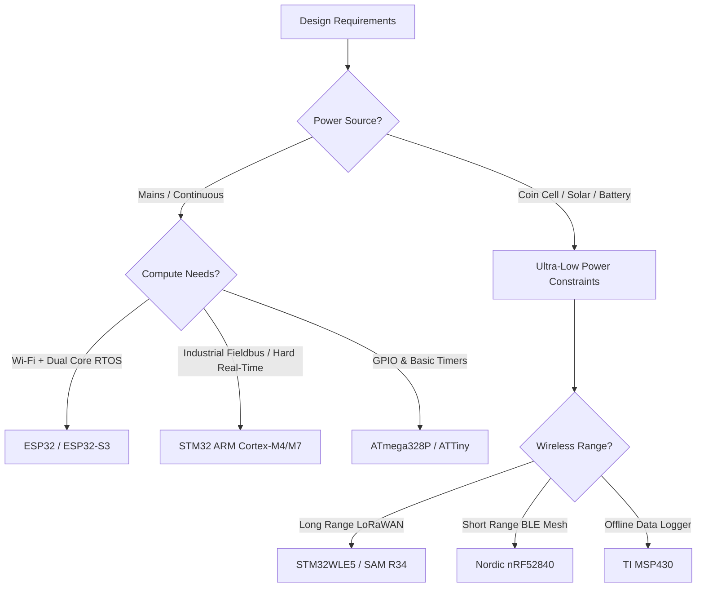

# Choosing the Right Microcontroller for Your IoT Project

Selecting the right microcontroller can make or break your IoT project. With so many options available, it's essential to understand the key factors that influence your decision.

## Key Factors to Consider

### 1. Processing Power

The computational requirements of your project will determine the minimum processing power needed:

- **Simple sensors**: 8-bit microcontrollers (ATmega series)
- **Complex data processing**: 32-bit ARM Cortex (ESP32, STM32)
- **Machine learning**: High-performance chips with dedicated accelerators

### 2. Connectivity Options

Modern IoT projects often require multiple connectivity options:

- **Wi-Fi**: ESP32, ESP8266 for wireless connectivity
- **Bluetooth**: ESP32 offers both Classic and BLE
- **LoRa**: For long-range, low-power applications
- **Cellular**: For remote locations without Wi-Fi

### 3. Power Consumption

Battery-powered projects demand careful consideration of power usage and duty cycle optimization. The theoretical operating lifetime $T_{\text{runtime}}$ is derived from average current draw:

$$
I_{\text{avg}} = I_{\text{active}} \cdot D + I_{\text{sleep}} \cdot (1 - D)
$$

$$
T_{\text{runtime}} = \frac{C_{\text{battery}}}{I_{\text{avg}}} = \frac{C_{\text{battery}}}{I_{\text{active}} \cdot \left(\frac{t_{\text{active}}}{t_{\text{active}} + t_{\text{sleep}}}\right) + I_{\text{sleep}} \cdot \left(\frac{t_{\text{sleep}}}{t_{\text{active}} + t_{\text{sleep}}}\right)}
$$

For example, an active current of $I_{\text{active}} = 120\text{ mA}$ for $200\text{ ms}$ paired with $I_{\text{sleep}} = 15\ \mu\text{A}$ across a $2400\text{ mAh}$ cell yields multi-year autonomous deployment.

```cpp
// Example: ESP32 deep sleep mode
esp_sleep_enable_timer_wakeup(60 * 1000000); // Wake up after 60 seconds
esp_deep_sleep_start();
```

---

## Architectural Decision Matrix

Use this quick-path flowchart to select the matching hardware tier for your design:



---

## Popular Platforms Compared

### ESP32
**Pros:**
- Built-in Wi-Fi and Bluetooth
- Dual-core processor
- Large community support
- Affordable

**Cons:**
- Higher power consumption
- 3.3V logic (needs level shifters for 5V devices)

### STM32
**Pros:**
- Excellent documentation
- Wide range of variants
- Professional-grade reliability
- Low power modes

**Cons:**
- Steeper learning curve
- No built-in wireless (requires external modules)

### Arduino (ATmega)
**Pros:**
- Beginner-friendly
- Massive library ecosystem
- Reliable and proven

**Cons:**
- Limited processing power
- No native wireless capabilities
- 5V logic can complicate modern sensor integration

## Real-World Example

For my recent smart home automation project, I chose the ESP32 because:

1. Built-in Wi-Fi eliminated the need for additional modules
2. Dual-core allowed me to handle UI and sensor processing separately
3. Cost-effective for prototyping multiple nodes
4. Large community meant quick solutions to common problems

## Conclusion

There's no one-size-fits-all answer. Consider your specific requirements:

- **Budget constraints** → Arduino or ESP8266
- **Complex processing** → ESP32 or STM32F4
- **Ultra-low power** → STM32L series
- **Rapid prototyping** → ESP32 or Arduino

The best microcontroller is the one that meets your project requirements while staying within your technical comfort zone and budget.

Happy building! 🔧
