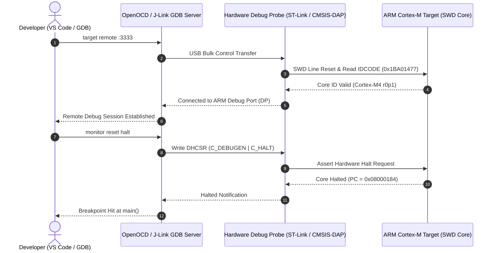

# Debugging Embedded Systems: Tips and Tools

Debugging embedded systems presents unique challenges compared to traditional software development. Here's a comprehensive guide to the essential techniques and tools.

## The Debugging Toolkit

### 1. Serial Debugging: Your First Line of Defense

```cpp
// ESP32 example
void setup() {
  Serial.begin(115200);
  Serial.println("System starting...");
}

void loop() {
  int sensorValue = analogRead(A0);
  Serial.printf("Sensor: %d, Free heap: %d\n", 
                sensorValue, ESP.getFreeHeap());
  delay(1000);
}
```

**Pro tip**: Use structured logging with prefixes:
```cpp
#define DEBUG_SENSOR "[SENSOR] "
#define DEBUG_NETWORK "[NET] "
#define DEBUG_ERROR "[ERROR] "

Serial.println(DEBUG_SENSOR "Temperature: 25.4°C");
```

### 2. LED Debugging: When Serial Isn't Available

The humble LED can save hours of debugging:

```cpp
#define DEBUG_LED 2

void signalError(int errorCode) {
  for(int i = 0; i < errorCode; i++) {
    digitalWrite(DEBUG_LED, HIGH);
    delay(200);
    digitalWrite(DEBUG_LED, LOW);
    delay(200);
  }
  delay(1000);
}
```

### 3. Logic Analyzers & Hardware Probes

Essential for verifying hardware timing, protocol violations, and bus integrity:
- **I2C/SPI communication**: Capture setup/hold violations ($t_{\text{SU:DAT}}$, $t_{\text{HD:DAT}}$)
- **Timing issues**: Glitch detection and clock jitter
- **Protocol verification**: Decoding Modbus, CAN, or UART frames

#### Bus Timing & Pull-Up Dimensioning

For reliable I2C communication at standard ($100\text{ kHz}$) or fast mode ($400\text{ kHz}$), pull-up resistors $R_p$ must satisfy rise-time and current sink limits governed by total bus capacitance $C_b$:

$$
R_{\min} = \frac{V_{DD} - V_{OL}}{I_{OL}}, \quad R_{\max} = \frac{t_r}{0.8473 \cdot C_b}
$$

For an asynchronous digital logic analyzer to reliably resolve digital transitions without aliasing, sampling frequency must obey:

$$
f_{\text{sample}} \ge 4 \cdot f_{\text{bus}}
$$

---

### Hardware Debugging Chain: GDB to SWD Target

Understanding the communication flow between your IDE and silicon hardware eliminates guesswork when breakpoints fail to bind:



---

## Common Debugging Scenarios

### Issue: I2C Device Not Responding

**Debug Steps:**
1. Check pull-up resistors (typically 4.7kΩ)
2. Scan I2C bus:

```cpp
#include <Wire.h>

void scanI2C() {
  Serial.println("Scanning I2C bus...");
  byte count = 0;
  
  for(byte i = 1; i < 127; i++) {
    Wire.beginTransmission(i);
    if(Wire.endTransmission() == 0) {
      Serial.printf("Device found at 0x%02X\n", i);
      count++;
    }
  }
  Serial.printf("Found %d device(s)\n", count);
}
```

3. Verify voltage levels (3.3V vs 5V)
4. Check physical connections

### Issue: Random Crashes/Resets

**Common causes:**
1. **Power issues**: Insufficient current, voltage drops
2. **Stack overflow**: Check stack size
3. **Watchdog timer**: Not being fed regularly
4. **Memory leaks**: Monitor heap usage

```cpp
// Watchdog feeding
void loop() {
  feedWatchdog();  // Reset watchdog timer
  
  // Your code here
  
  // Monitor memory
  if(ESP.getFreeHeap() < 10000) {
    Serial.println("WARNING: Low memory!");
  }
}
```

### Issue: Timing Problems

Use built-in timers for precise measurements:

```cpp
unsigned long startTime, endTime;

startTime = micros();
performCriticalOperation();
endTime = micros();

Serial.printf("Operation took %lu µs\n", endTime - startTime);
```

## Advanced Debugging Techniques

### 1. Assert Statements

```cpp
#define ASSERT(condition, message) \
  if(!(condition)) { \
    Serial.printf("ASSERT FAILED: %s at %s:%d\n", \
                  message, __FILE__, __LINE__); \
    while(1); \
  }

ASSERT(temperature < 100, "Temperature too high!");
```

### 2. Memory Dumping

```cpp
void dumpMemory(uint8_t* addr, size_t len) {
  for(size_t i = 0; i < len; i++) {
    if(i % 16 == 0) Serial.printf("\n%08X: ", (uint32_t)(addr + i));
    Serial.printf("%02X ", addr[i]);
  }
  Serial.println();
}
```

### 3. State Machines with Debug Output

```cpp
enum State {
  INIT,
  CONNECTING,
  CONNECTED,
  ERROR
};

State currentState = INIT;

void setState(State newState) {
  const char* stateNames[] = {"INIT", "CONNECTING", "CONNECTED", "ERROR"};
  Serial.printf("State: %s -> %s\n", 
                stateNames[currentState], 
                stateNames[newState]);
  currentState = newState;
}
```

## Essential Hardware Tools

### Must-Have
1. **Multimeter**: Voltage, current, continuity checking
2. **USB-to-Serial adapter**: For debugging without built-in USB
3. **Cheap logic analyzer**: Protocol debugging
4. **Oscilloscope**: For analog signals and noise issues

### Nice-to-Have
1. **Bench power supply**: Stable, adjustable power
2. **Hot air station**: For SMD rework
3. **Proper debugger**: ST-Link, J-Link for ARM debugging

## Software Tools

### Free & Essential
- **Arduino IDE/PlatformIO**: Development and debugging
- **PuTTY/CoolTerm**: Serial terminal
- **Sigrok PulseView**: Logic analyzer software

### Professional
- **Segger Ozone**: Advanced debugging
- **Percepio Tracealyzer**: RTOS debugging

## Best Practices

1. **Add debug code early**: Don't wait until things break
2. **Use version control**: Track what changed when issues appeared
3. **Document weird behaviors**: They often come back
4. **Keep a debug log**: Track issues and solutions
5. **Test incrementally**: Don't change too much at once

## Debugging Workflow

```
1. Reproduce the issue consistently
   ↓
2. Add logging around the problem area
   ↓
3. Form a hypothesis
   ↓
4. Test the hypothesis
   ↓
5. Fix and verify
   ↓
6. Document the solution
```

## Conclusion

Embedded debugging is part art, part science. The key is having the right tools and methodologies. Start with simple serial debugging, and gradually add more sophisticated tools as needed.

Remember: **The best debugging tool is a clear understanding of your system.**

Happy debugging! 🔍
