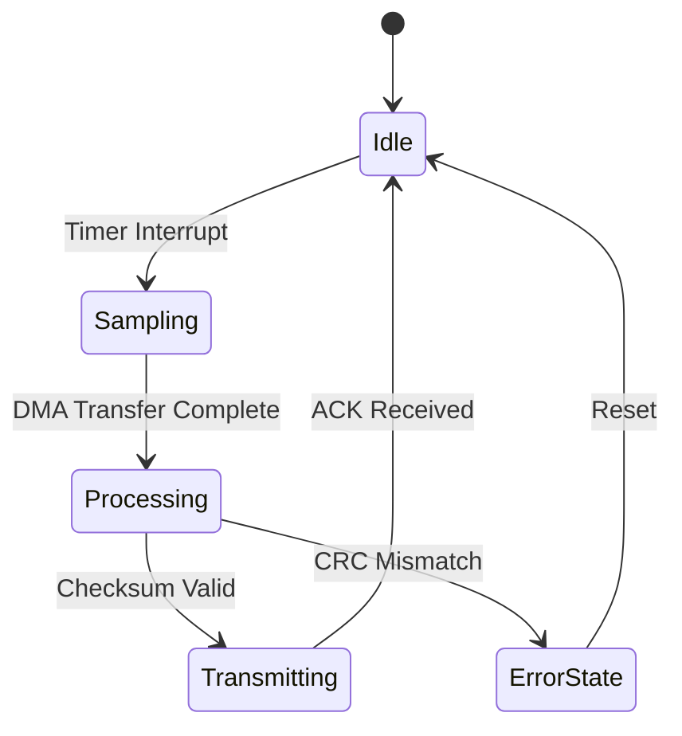

# Sieva SSG: Component & Syntax Reference Guide

Welcome to the **Sieva Site Generator (v2)** interactive syntax reference. This page serves as a living test fixture and demonstration of all Markdown extensions, frontmatter options, and embedded UI directives supported by the Go static site engine.

---

## 1. Post Frontmatter Specification

Every article, note, or project begins with standard YAML frontmatter enclosed in `---` delimiters:

```yaml
---
title: "Article Title"
date: "2026-10-16"
description: "A concise summary for cards, RSS feeds, and SEO meta tags."
tags: ["Go", "Embedded", "Performance"]
featured: true # Highlights the post on the homepage
---
```

### Frontmatter Fields

| Field | Type | Required | Description |
| :--- | :--- | :--- | :--- |
| `title` | `string` | **Yes** | Display title rendered in `<h1>` and meta tags. |
| `date` | `YYYY-MM-DD` | **Yes** | Publication date used for chronological sorting. |
| `description` | `string` | Optional | Article snippet displayed on index rows and openGraph. |
| `tags` | `array` | Optional | Categorization tags indexed under `/tags/<tag>/`. |
| `featured` | `boolean` | Optional | Pins the article to the featured list on the homepage. |

---

## 2. Interactive Image Galleries (`Gallery:`)

The parser natively handles the `Gallery:` directive. Simply list image filenames separated by commas. Images reside directly in the bundle's `img/` folder or organized subdirectories (e.g. `content/blog/<slug>/img/subfolder/` or `content/projects/<slug>/img/subfolder/`), with optional custom captions in parentheses:

```markdown
# Standard filenames:
Gallery: test1.png, test2.png, test3.png

# Subfolders and custom captions:
Gallery: benchmarks/thermal-scan.png (Thermal Chamber Run), scope/spi-clk.png (SPI Clock Jitter)
```

### Rendered Gallery Output:

Gallery: test1.png, test2.png, test3.png

*(Click any thumbnail above to view it in full resolution with the native keyboard-accessible lightbox).*

---

## 3. Skill & Competency Grids (`SkillCards:`)

Use the `SkillCards:` shortcode to render grouped skill boxes without writing messy HTML:

```markdown
SkillCards:
  Title: Firmware & Bare Metal | Items: C (C99/C11), C++20, FreeRTOS, Embedded Linux, Zephyr RTOS
  Title: Hardware & Interfaces | Items: ARM Cortex-M, ESP32, STM32, SPI, I2C, CAN Bus, UART, PCB Layout
  Title: Systems & Toolchains | Items: Go, Rust, Python, Docker, Git, GDB, Oscilloscopes, Logic Analyzers
```

### Rendered Skill Cards Output:

SkillCards:
  Title: Firmware & Bare Metal | Items: C (C99/C11), C++20, FreeRTOS, Embedded Linux, Zephyr RTOS
  Title: Hardware & Interfaces | Items: ARM Cortex-M, ESP32, STM32, SPI, I2C, CAN Bus, UART, PCB Layout
  Title: Systems & Toolchains | Items: Go, Rust, Python, Docker, Git, GDB, Oscilloscopes, Logic Analyzers

---

## 4. Contact & Social Action Badges (`ContactButtons:`)

You can generate styled action buttons linked directly to your social and communication channels configured in `config.json`:

```markdown
ContactButtons: Email, GitHub, LinkedIn
```

### Rendered Buttons Output:

ContactButtons: Email, GitHub, LinkedIn

---

## 5. Code Blocks & Automated Copy Buttons

All fenced code blocks automatically receive syntax-aware styling and a **Copy** button:

```go
package main

import "fmt"

func main() {
    // Zero-bloat static compilation in Go
    fmt.Println("Deterministic single-pass builds under 150ms!")
}
```

```bash
# Production release build (skips all demo-* content)
./sieva-ssg.exe build

# Development build including demo fixtures
./sieva-ssg.exe build-demo

# Start auto-rebuilding local dev server
./sieva-ssg.exe dev --port 8000
```

---

## 6. Semantic Callouts & Blockquotes

Standard Markdown blockquotes are styled with theme-aware accent borders:

> **Engineering Principle:** Computational waste is a bug. Static web pages do not need runtime JavaScript interpreters or dynamic layout recalculation on every browser paint. Pre-render vector assets at build time.

---

## 7. Responsive Tables

Tables are styled with alternating zebra rows, sticky header contrast, and clean borders:

| Feature | Sieva SSG (v2) | Legacy Deno (v1) | Next.js / Astro |
| :--- | :--- | :--- | :--- |
| **Language** | Go (single binary) | Deno + TypeScript | Node.js + npm |
| **Build Time** | **~104 ms** | 2.8 - 4.2 s | 4.0 - 12.0 s |
| **Client JavaScript** | **< 2.5 KB** | ~46 KB | 80 - 250 KB |
| **Gantt Charts** | **Build-time Vector SVG** | Client runtime script | React library |
| **Lighthouse Performance** | **100 / 100** | 94 / 100 | 85 - 95 / 100 |

---

## 8. Mathematical Typography (`$...$` and `$$...$$`)

Sieva SSG integrates LaTeX mathematical expression parsing. Enclose inline math within single dollar signs (`$...$`) and standalone equation blocks within double dollar signs (`$$...$$`).

Crucially, **KaTeX is loaded strictly on-demand**. If an article has no math expressions, 0 KB of KaTeX scripts or stylesheets are delivered to the browser.

### Inline Math Example:

A classic physics relation: $E = m c^2$, or Euler's identity: $e^{i\pi} + 1 = 0$.

### Block Equation Example:

Discrete Fourier Transform (DFT) synthesis equation:

$$
X[k] = \sum_{n=0}^{N-1} x[n] \cdot e^{-j \frac{2\pi}{N} k n}, \quad k = 0, \dots, N-1
$$

Ohm's Law and Power in complex AC circuits:

$$
P = \frac{1}{T} \int_{0}^{T} v(t) \cdot i(t) \, dt = V_{\text{rms}} \cdot I_{\text{rms}} \cdot \cos(\varphi)
$$

---

## 9. Interactive Mermaid Diagrams (` ```mermaid `)

Complex technical specifications, state machines, and embedded communication pipelines can be drawn natively in Markdown using standard fenced code blocks with the `mermaid` language identifier:

````markdown

````

### Rendered Diagram Output:


Like the math engine, Mermaid is loaded **on-demand only when a page contains a `.mermaid` block**. Furthermore, the diagram listener is wired into the theme toggle: switching between Dark Mode and Light Mode automatically re-renders the diagram using appropriate palette variables.

---

*This guide is generated automatically when building in demo mode (`sieva-ssg build-demo` or `sieva-ssg dev`). In production release builds (`sieva-ssg build`), all `demo-*` files are skipped automatically.*

