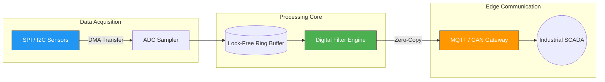

# Project Architecture & Interactive Feature Showcase

This page demonstrates how to structure complex engineering projects in **Sieva Site Generator (v2)**.

Every project lives in its own subdirectory under `content/projects/<slug>/` and can include:
1. An index article with project metadata, schedule charts, and high-level architecture.
2. An interactive pullout timeline drawer with smooth-scrolling anchors.
3. Chronological development milestone logs (`updates`) rendered beneath the article.

---

## <a id="gantt-config"></a>1. Gantt Chart Frontmatter Configuration

To enable the build-time vector Gantt chart, define a `gantt:` list in the frontmatter of your project's index file:

```yaml
gantt:
  - name: "Hardware Schematic & PCB"
    start: "2026-01-10"
    end: "2026-02-15"
    progress: 100
    color: "#4CAF50" # Hex color for the progress bar
  - name: "Board Bring-up & Drivers"
    start: "2026-02-10"
    end: "2026-03-20"
    progress: 80
    color: "#2196F3"
```

The SSG engine parses these dates, calculates start/end intervals, generates month dividers, and pre-renders crisp, accessible `<svg>` markup directly into the static HTML.

* **No client JavaScript execution required**: 0ms script overhead on page load.
* **Click to Enlarge**: Clicking the chart or the header button opens an enlarged view inside a native HTML5 modal dialog.

---

## <a id="sidebar-setup"></a>2. Pullout Breadcrumb Sidebar Setup

For long technical projects, whitepapers, or hardware documentation, the pullout timeline gives visitors instant breadcrumb navigation:

```yaml
timeline:
  - title: "Schematic Architecture"
    date: "2026-01-10"
    link: "#schematic"
  - title: "Firmware Bring-Up"
    date: "2026-02-10"
    link: "#firmware"
```

When `timeline:` items exist, a floating **📅 Timeline** tab button appears on the right edge of the viewport. Clicking it slides open a drawer containing clickable breadcrumbs that smoothly scroll the page directly to each section anchor.

---

## <a id="update-logs"></a>3. Chronological Development Update Logs

Engineering projects often involve iterative revisions, hardware bring-up notes, and firmware releases.

Instead of stuffing everything into one massive file, place separate Markdown files in the same project directory:
* `content/projects/my-project/index.md` (Main project page)
* `content/projects/my-project/update-01-hardware-rev-b.md` (Update log 1)
* `content/projects/my-project/update-02-field-testing.md` (Update log 2)

The engine automatically aggregates all non-index files, sorts them by date descending, and renders them in the **Development Log & Field Updates** timeline at the bottom of the project page.

---

## <a id="clean-urls"></a>4. Symmetric Clean Directory URLs

Every project is rendered with symmetric directory-based URLs:
* `dist/projects/<slug>/index.html` → Accessible at `/projects/<slug>/`
* No server-side `.php`, `.html`, or URL rewriting modules required.
* Functions natively on Apache, Nginx, Caddy, Cloudflare Pages, or GitHub Pages.

---

## <a id="math-and-diagrams"></a>5. Architecture Diagrams & Mathematical Modeling

Sieva SSG natively supports **Mermaid.js** diagrams and **LaTeX mathematical expressions** via KaTeX. Crucially, these heavy client runtimes are loaded **strictly on-demand**—pages without math or diagrams incur 0 KB overhead.

### Subsystem Flow Diagram (Mermaid)



### Engineering Math Modeling (LaTeX)

For ADC resolution and quantization noise analysis, theoretical signal-to-noise ratio is calculated via:

$$
\text{SNR}_{\text{ideal}} = 6.02 \cdot N + 1.76 \text{ dB}
$$

Where $N$ represents the effective number of bits (ENOB). For a first-order low-pass anti-aliasing RC filter with cut-off frequency $f_c = \frac{1}{2\pi R C}$, the transfer function magnitude is modeled as:

$$
|H(j\omega)| = \frac{1}{\sqrt{1 + (\omega R C)^2}} = \frac{1}{\sqrt{1 + \left(\frac{f}{f_c}\right)^2}}
$$

Inline formulas like $f_s \ge 2 f_{\max}$ (Nyquist rate) integrate into regular paragraphs with zero layout shift.
